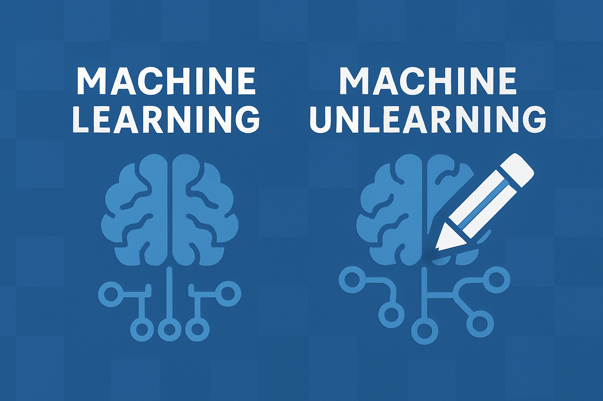
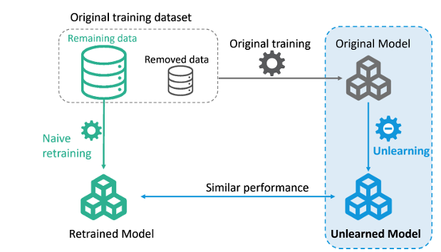
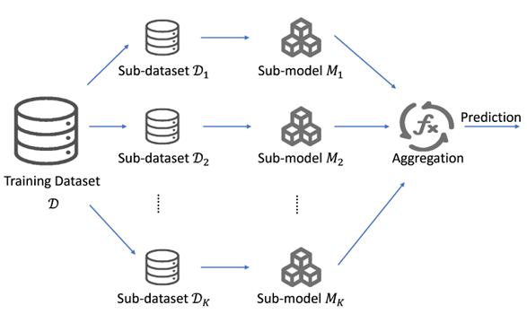

## 1. Giới thiệu

Trong kỷ nguyên của Trí tuệ Nhân tạo (AI), các mô hình học máy ngày càng trở nên mạnh mẽ và được ứng dụng rộng rãi trong nhiều lĩnh vực của đời sống. Tuy nhiên, đi kèm với sự phát triển này là những lo ngại về quyền riêng tư và đạo đức liên quan đến việc thu thập và sử dụng dữ liệu cá nhân.

Hãy tưởng tượng một mô hình AI được đào tạo trên dữ liệu của hàng triệu người dùng, bao gồm cả những thông tin nhạy cảm như lịch sử tìm kiếm, vị trí và thông tin tài chính. Nếu một người dùng muốn xóa dữ liệu của họ khỏi mô hình này, liệu điều đó có khả thi? Kiểu như bạn từng "lỡ" dạy AI nhận diện món phở, xong nó nhận diện nhầm tô bún riêu nhà kế bên? Hoặc "lỡ" cho AI xem hết ảnh "dìm hàng" của bạn, giờ nó đem đi "tám chuyện" với AI khác? Làm thế nào chúng ta có thể đảm bảo rằng AI "quên" đi những gì đã học, đồng thời duy trì hiệu suất của mô hình?

<div align="center">
    <figure>
        
        <figcaption> Machine Learning và Machine Unlearning.</figcaption>
    </figure>
</div>

Đây chính là lúc Machine Unlearning xuất hiện, như một "cục tẩy" cho AI. Machine Unlearning là một lĩnh vực nghiên cứu mới nổi, tập trung vào việc phát triển các phương pháp cho phép các mô hình học máy loại bỏ thông tin cụ thể khỏi quá trình đào tạo. Nói một cách đơn giản, Machine Unlearning giúp AI "quên" đi những dữ liệu không còn cần thiết hoặc không phù hợp, từ đó bảo vệ quyền riêng tư của người dùng và giải quyết các vấn đề đạo đức liên quan đến việc sử dụng AI. Kiểu như, khi bạn muốn AI "quên" đi mấy tấm hình "dìm hàng" kia, machine unlearning sẽ giúp AI "xoá kí ức" nhẹ nhàng.

Trong bài blog này, chúng ta sẽ cùng nhau khám phá sâu hơn về Machine Unlearning, bao gồm các phương pháp, thách thức và ứng dụng tiềm năng của nó. Hãy cùng nhau tìm hiểu về tương lai của việc kiểm soát dữ liệu trong kỷ nguyên AI!


## 2. Các phương pháp Machine Unlearning

### 2.1. Định nghĩa các tập dữ liệu

Trước khi đi vào các phương pháp cụ thể, việc định nghĩa rõ ràng các tập dữ liệu liên quan là bước đầu tiên và quan trọng. Điều này giúp chúng ta có một khung làm việc rõ ràng và chính xác trong quá trình Machine Unlearning.

* $D$: Tập dữ liệu gốc, dùng để huấn luyện mô hình ban đầu.
* $D_{retain}$: Tập dữ liệu còn lại, sau khi loại bỏ dữ liệu cần quên.
* $D_{forget}$: Tập dữ liệu cần quên, sẽ được loại bỏ ảnh hưởng khỏi mô hình.

### 2.2. Định nghĩa Machine Unlearning

Theo bài báo [[Xu et al., 2024]](#xu2024), Machine Unlearning (Học máy Bỏ học) là quá trình loại bỏ ảnh hưởng của các điểm dữ liệu huấn luyện cụ thể khỏi một mô hình học máy đã được huấn luyện. Cụ thể, một mô hình với bộ tham số $\mathbf{w}^*$ được huấn luyện trên tập dữ liệu $D$ sử dụng thuật toán $A$, và tập dữ liệu con $D_{forget}$, một phần của $D$, cần được loại bỏ. Thuật toán Học máy quên dữ liệu $U(A(D), D, D_{forget})$ nhằm mục đích xây dựng được mô hình mới với bộ tham số $\mathbf{w}^-$ bằng cách loại bỏ ảnh hưởng của $D_{forget}$ trong khi vẫn giữ nguyên hiệu suất của mô hình trên $D \setminus D_{forget}$.

### 2.3. Naive Retraining (Huấn luyện lại ngây thơ)

Naive Retraining là phương pháp cơ bản nhất, liên quan đến việc loại bỏ điểm dữ liệu không mong muốn khỏi tập dữ liệu huấn luyện và huấn luyện lại mô hình từ đầu. Phương pháp này thường được sử dụng làm cơ sở để đánh giá các kỹ thuật unlearning phức tạp hơn.

#### Định nghĩa 1

Cho một thuật toán học máy $A(\cdot)$, tập dữ liệu huấn luyện $D$, và một tập dữ liệu huấn luyện $D_{forget}$ cần loại bỏ, naive retraining bao gồm việc huấn luyện lại trên tập dữ liệu đã sửa đổi $D \setminus D_{forget}$. Về mặt toán học, nó có thể được biểu diễn như sau:

$$A(D \setminus D_{forget})$$

<div align="center">
    <figure>
        
        <figcaption> Minh họa quá trình Naive Retraining - Huấn luyện lại mô hình từ đầu sau khi loại bỏ dữ liệu.</figcaption>
    </figure>
</div>

### 2.4. Phân loại các phương pháp Unlearning

Các phương pháp Machine Unlearning có thể được phân loại thành hai hướng tiếp cận chính: Exact Unlearning và Approximate Unlearning. Mỗi phương pháp có những ưu và nhược điểm riêng, phù hợp với các tình huống và yêu cầu khác nhau.


#### a. Exact Unlearning (Unlearning chính xác)

Exact Unlearning là phương pháp Machine Unlearning lý tưởng, hướng tới việc tạo ra một mô hình $M'$ có phân phối xác suất hoàn toàn giống với mô hình được huấn luyện trực tiếp trên tập dữ liệu còn lại $D_{retain}$. Nói cách khác, $M'$ phải tương đương với mô hình được tạo ra từ $Train(D_{retain})$, trong đó $Train(\cdot)$ là thuật toán huấn luyện được sử dụng.

**Định nghĩa:**

Cho một mô hình gốc $M$ được huấn luyện trên tập dữ liệu $D$ với phân phối $P_D(x, y)$, và một tập dữ liệu $D_{forget}$ cần được loại bỏ. Exact Unlearning tìm cách tạo ra mô hình $M'$ với phân phối $P_{D_{retain}}(x, y)$, sao cho:

$$P_{M'}(x, y) = P_{Train(D_{retain})}(x, y)$$

**Công thức lý tưởng:**

Mục tiêu là đạt được một mô hình $M'$ sao cho:

<div align="center">
    $$ M' = Train(D_{retain}) $$
</div>

trong đó, $Train(D_{retain})$ là hàm huấn luyện mô hình trên tập dữ liệu $D_{retain}$.

**Độ đo:**

Để đánh giá mức độ thành công của Exact Unlearning, chúng ta có thể sử dụng các độ đo dựa trên sự khác biệt phân phối, chẳng hạn như:

* **Khoảng cách Kullback-Leibler (KL divergence):**

$$D_{KL}(P_{M'} || P_{Train(D_{retain})}) = 0$$

* **Khoảng cách Wasserstein:**

$$W(P_{M'}, P_{Train(D_{retain})}) = 0$$

Các độ đo này đánh giá sự khác biệt giữa phân phối của mô hình sau khi unlearning ($P_{M'}$) và phân phối của mô hình được huấn luyện lại từ $D_{retain}$ ($P_{Train(D_{retain})}$). Giá trị càng nhỏ, quá trình Exact Unlearning càng thành công.

**Khó khăn:**

Tuy nhiên, việc đạt được Exact Unlearning thường gặp các khó khăn sau:

* **Tính toán tốn kém:** Huấn luyện lại toàn bộ mô hình từ $D_{retain}$ có thể rất tốn kém, đặc biệt đối với các mô hình lớn và phức tạp.
* **Tính khả thi:** Trong một số trường hợp, việc tính toán lại chính xác phân phối là không khả thi hoặc không thể thực hiện được trong thời gian hợp lý.

#### b. Approximate Unlearning (Unlearning xấp xỉ)

Approximate Unlearning là một hướng tiếp cận thực tế hơn so với Exact Unlearning, nhằm mục đích giảm thiểu ảnh hưởng của $D_{forget}$ lên mô hình mà không cần phải huấn luyện lại từ đầu trên $D_{retain}$. Thay vì tạo ra một mô hình có phân phối hoàn toàn giống $Train(D_{retain})$, Approximate Unlearning tập trung vào việc tạo ra một mô hình có phân phối gần giống nhất có thể, đồng thời giảm thiểu chi phí tính toán.

**Định nghĩa:**

Cho một mô hình gốc $M$ được huấn luyện trên tập dữ liệu $D$ với phân phối $P_D(x, y)$, và một tập dữ liệu $D_{forget}$ cần được loại bỏ. Approximate Unlearning tìm cách tạo ra mô hình $M'$ sao cho phân phối $P_{M'}(x, y)$ càng gần với phân phối $P_{Train(D_{retain})}(x, y)$ càng tốt, với chi phí tính toán chấp nhận được.

**Mục tiêu:**

Tối thiểu hóa sự khác biệt giữa phân phối của mô hình sau unlearning ($P_{M'}$) và phân phối của mô hình được huấn luyện lại từ $D_{retain}$ ($P_{Train(D_{retain})}$), đồng thời giảm thiểu chi phí tính toán.

**Độ đo:**

Tương tự như Exact Unlearning, chúng ta có thể sử dụng các độ đo dựa trên sự khác biệt phân phối để đánh giá hiệu quả của Approximate Unlearning với tham số ngưỡng (threshold) $\epsilon$:

* **Khoảng cách Kullback-Leibler (KL divergence):**

    $$D_{KL}(P_{M'} || P_{Train(D_{retain})}) \leq \epsilon$$

* **Khoảng cách Wasserstein:**

    $$W(P_{M'}, P_{Train(D_{retain})}) \leq \epsilon$$

Ngoài ra, chúng ta cần xem xét thêm các độ đo về chi phí tính toán, chẳng hạn như thời gian unlearning và chi phí phần cứng.

**Các phương pháp phổ biến:**

Approximate Unlearning bao gồm nhiều phương pháp khác nhau, mỗi phương pháp có cách tiếp cận riêng để giảm thiểu chi phí tính toán. Một số phương pháp phổ biến bao gồm:

* **Sử dụng Score function:** Ước lượng và giảm thiểu ảnh hưởng của các điểm dữ liệu trong $D_{forget}$ bằng cách điều chỉnh trọng số của mô hình.
* **Phương pháp SISA (Sharded, Isolated, Sliced, Aggregated):**
    * SISA là một kỹ thuật Approximate Unlearning hiệu quả, trong đó dữ liệu được chia thành nhiều "shards" (phần nhỏ), mô hình được huấn luyện trên từng shard, và quá trình unlearning chỉ cần huấn luyện lại các mô hình trên các shard bị ảnh hưởng bởi $D_{forget}$.
    * Điều này giúp tránh việc huấn luyện lại toàn bộ mô hình, tiết kiệm đáng kể chi phí.
* **Phương pháp dựa trên giải thuật SVD (Singular Value Decomposition):** Phân tích ma trận dữ liệu để ước lượng và loại bỏ ảnh hưởng của $D_{forget}$.

**Công thức chung (ví dụ về SISA):**

<div align="center">
    <figure>
        
        <figcaption> SISA Framework.</figcaption>
    </figure>
</div>

Công thức sau minh họa cách SISA hoạt động:

<div align="center">
    $$M' = Aggregate(Train(Shard_1), Train(Shard_2), ..., Train(Shard_n))$$
</div>

trong đó, $Aggregate()$ là hàm tổng hợp các mô hình con được huấn luyện trên các shard.

## 3. Đánh giá Machine Unlearning

Sau khi đã triển khai các phương pháp unlearning, việc đánh giá hiệu quả của chúng là bước không thể thiếu. Phần này sẽ trình bày các tiêu chí và phương pháp đánh giá để đảm bảo rằng quá trình unlearning diễn ra thành công và an toàn. Các tiêu chí đánh giá có thể được phân thành các nhóm sau:

### 3.1. Hiệu suất mô hình (Performance)

#### a. Độ chính xác (Accuracy)

* **Trên tập dữ liệu quên (Forget Set):**
    * Đánh giá sự giảm độ chính xác trên tập dữ liệu này để xác định mức độ "quên" của mô hình.
    * So sánh độ chính xác của mô hình sau unlearning với mô hình được huấn luyện lại trên tập dữ liệu quên (retrained model) để đảm bảo tính nhất quán.
* **Trên tập dữ liệu giữ lại (Retain Set):**
    * Đảm bảo rằng mô hình sau unlearning vẫn duy trì hiệu suất trên tập dữ liệu này.
    * So sánh độ chính xác của mô hình sau unlearning với mô hình gốc để đánh giá sự chênh lệch.
* **Trên tập dữ liệu kiểm tra (Test Set):**
    * Đảm bảo rằng mô hình sau unlearning vẫn có hiệu suất tốt trên tập dữ liệu kiểm tra, để đánh giá khả năng tổng quát hóa của mô hình.

#### b. Thời gian Unlearn (Unlearn Time)

Đo lường thời gian cần thiết để thực hiện quá trình unlearning.

#### c. Thời gian Học lại (Relearn Time)

Đo lường thời gian (hoặc số epoch) cần thiết để mô hình "học lại" thông tin đã quên bằng cách huấn luyện lại trên tập dữ liệu quên.

### 3.2. Bảo mật và Rò rỉ thông tin (Security and Information Leakage)

#### a. Các phương pháp tấn công (Attack-based Evaluation)

* Sử dụng các phương pháp tấn công như Membership Inference Attack (MIA) hoặc Inversion Attack để đánh giá mức độ rò rỉ thông tin không mong muốn.
* So sánh mức độ rò rỉ thông tin giữa mô hình trước và sau unlearning.


## 4. Cùng bắt tay vào code nào!!!
Ở phần này, mình sẽ sử dụng lại code hướng dẫn của **NeurIPS 2023 Machine Unlearning Challenge Starting Kit** cho nó legit!!
### 4.1. Import các thư viện cần thiết
```python
import os
import requests
import numpy as np
import matplotlib.pyplot as plt
from sklearn import linear_model, model_selection
import torch
from torch import nn
from torch import optim
from torch.utils.data import DataLoader
import torchvision
from torchvision import transforms
from torchvision.utils import make_grid
from torchvision.models import resnet18
DEVICE = "cuda"  if torch.cuda.is_available()  else  "cpu"
print("Running on device:", DEVICE.upper())

# manual random seed is used for dataset partitioning
# to ensure reproducible results across runs
RNG = torch.Generator().manual_seed(42)
```
Phần này đơn giản, không có gì phải giải thích, nếu không hiểu thì bạn có thể coi lại các phần về Machine Learning cơ bản và đọc tài liệu của PyTorch.
### 4.2. Tải dữ liệu và mô hình đã được huấn luyện
Ở phần này, thì code mẫu người ta sẽ sử dụng dataset là **CIFAR-10** và pre-trained model là **ResNet18** (đương nhiên cũng đã được train trên CIFAR10 sẵn, load weight thôi). Các công việc bao gồm:
#### a. Tải dữ liệu

- **Tải và tiền xử lý dữ liệu CIFAR-10:** Đoạn code tải bộ dữ liệu CIFAR-10, chia nó thành các tập train, test, và validation, đồng thời áp dụng các phép biến đổi (normalize) lên dữ liệu.
- **Tạo tập "forget" và "retain":** Code tải các index của tập "forget" từ một file, sau đó sử dụng các index này để chia tập train ban đầu thành hai tập con: "forget" (dữ liệu cần quên) và "retain" (dữ liệu cần giữ lại).
- **Tạo DataLoader cho các tập dữ liệu:** Cuối cùng, code tạo các DataLoader để dễ dàng load dữ liệu theo batch trong quá trình huấn luyện và đánh giá mô hình.

```python
# download and pre-process CIFAR10
normalize = transforms.Compose([
    transforms.ToTensor(),
    transforms.Normalize((0.4914, 0.4822, 0.4465), (0.2023, 0.1994, 0.2010)),
])

train_set = torchvision.datasets.CIFAR10(
    root="./data", train=True, download=True, transform=normalize
)
train_loader = DataLoader(train_set, batch_size=128, shuffle=True, num_workers=2)

# we split held out data into test and validation set
held_out = torchvision.datasets.CIFAR10(
    root="./data", train=False, download=True, transform=normalize
)
test_set, val_set = torch.utils.data.random_split(held_out, [0.5, 0.5], generator=RNG)
test_loader = DataLoader(test_set, batch_size=128, shuffle=False, num_workers=2)
val_loader = DataLoader(val_set, batch_size=128, shuffle=False, num_workers=2)

# download the forget and retain index split
local_path = "forget_idx.npy"
if not os.path.exists(local_path):
    response = requests.get(
        "https://storage.googleapis.com/unlearning-challenge/" + local_path
    )
    open(local_path, "wb").write(response.content)
forget_idx = np.load(local_path)

# construct indices of retain from those of the forget set
forget_mask = np.zeros(len(train_set.targets), dtype=bool)
forget_mask[forget_idx] = True
retain_idx = np.arange(forget_mask.size)[~forget_mask]

# split train set into a forget and a retain set
forget_set = torch.utils.data.Subset(train_set, forget_idx)
retain_set = torch.utils.data.Subset(train_set, retain_idx)

forget_loader = torch.utils.data.DataLoader(
    forget_set, batch_size=128, shuffle=True, num_workers=2
)
retain_loader = torch.utils.data.DataLoader(
    retain_set, batch_size=128, shuffle=True, num_workers=2, generator=RNG
)
```
Tải xong rồi thì làm gì nựa, đương nhiên là show dữ liệu ra rồi
```python
# a temporary data loader without normalization, just to show the images
tmp_dl = DataLoader(
	torchvision.datasets.CIFAR10(
		root="./data", train=True, download=True, transform=transforms.ToTensor()
	),
	batch_size=16 * 5,
	shuffle=False,
	)

images, labels = next(iter(tmp_dl))

fig, ax = plt.subplots(figsize=(12,  6))
plt.title("Sample images from CIFAR10 dataset")
ax.set_xticks([])
ax.set_yticks([])
ax.imshow(make_grid(images, nrow=16).permute(1,  2,  0))
plt.show()
```

#### b. Tải mô hình đã được huấn luyện
Phần này nó cho bộ trọng số ở đâu thì cứ tải ở đó thôi (hoặc nếu bạn thuộc loại trâu bò thì có thể huấn luyện lại)
```python
# download pre-trained weights
local_path = "weights_resnet18_cifar10.pth"
if  not os.path.exists(local_path):
	response = requests.get(
	"https://storage.googleapis.com/unlearning-challenge/weights_resnet18_cifar10.pth"
)

open(local_path,  "wb").write(response.content)
weights_pretrained = torch.load(local_path, map_location=DEVICE)

# load model with pre-trained weights
model = resnet18(weights=None, num_classes=10)
model.load_state_dict(weights_pretrained)
model.to(DEVICE)
model.eval();
```
Kế tiếp, trong code mẫu người ta cũng định nghĩa cả hàm tính **accuracy** (mặc dù theo mình thấy thì xài có sẵn cũng được)
```python
def  accuracy(net, loader):
	"""Return accuracy on a dataset given by the data loader."""
	correct = 0
	total = 0
	for inputs, targets in loader:
		inputs, targets = inputs.to(DEVICE), targets.to(DEVICE)
		outputs = net(inputs)
		_, predicted = outputs.max(1)
		total += targets.size(0)
		correct += predicted.eq(targets).sum().item()
	return correct / total

print(f"Train set accuracy: {100.0 * accuracy(model, train_loader):0.1f}%")
print(f"Test set accuracy: {100.0 * accuracy(model, test_loader):0.1f}%")
```
### 4.3. Thuật toán Unlearning
Trong phần này, chúng ta sẽ đi sâu vào việc xây dựng thuật toán Unlearning. Như các bạn đã biết, ở phần trước, chúng ta đã chia tập dữ liệu huấn luyện gốc thành hai mảnh: tập **retain** (dữ liệu mà chúng ta muốn giữ lại trong mô hình) và tập **forget** (dữ liệu mà chúng ta muốn mô hình quên đi). Thông thường, trong thực tế, tập **retain** sẽ chiếm phần lớn hơn nhiều so với tập **forget**. Để đơn giản hóa ví dụ, chúng ta sẽ giả sử tỉ lệ chia là 90% cho **retain** và 10% cho **forget**. Mục tiêu cốt lõi của bất kỳ thuật toán Unlearning nào là tạo ra một mô hình mới, sao cho nó càng giống càng tốt với một mô hình lý tưởng, tức là mô hình chỉ được huấn luyện duy nhất trên tập **retain** mà không hề "nhìn thấy" bất kỳ dữ liệu nào trong tập **forget**. Nói một cách dễ hiểu, chúng ta muốn "tẩy" đi những gì mà mô hình đã học được từ tập **forget**.

Để minh họa cho khái niệm này, chúng ta sẽ bắt đầu với một thuật toán Unlearning cơ bản, được gọi là "Unlearning bằng tinh chỉnh" (Unlearning by Fine-tuning). Ý tưởng của thuật toán này rất đơn giản: chúng ta lấy mô hình đã được huấn luyện sẵn và tiếp tục huấn luyện nó trên tập **retain** trong một số vòng lặp (epoch). Mặc dù dễ thực hiện, thuật toán tinh chỉnh thường không phải là lựa chọn tối ưu. Nó có thể tốn kém về mặt tính toán và không đảm bảo hiệu quả tốt nhất khi đánh giá bằng các tiêu chí phức tạp hơn, nhưng, như câu nói ***Ai cũng phải bắt đầu từ đâu đó*** (không nhớ của ai, cứ chém thôi) thì đây là một thuật toán tốt để bắt đầu.

Thuật toán này nhìn chung khá đơn giản, đúng hơn là cái flow chứ cũng không toán tiếc gì, cốt lõi bao gồm:

- **Tinh chỉnh mô hình:** Tiếp tục huấn luyện mô hình đã được huấn luyện trước đó (pre-trained model) trên tập dữ liệu **retain**.
- **Bỏ qua dữ liệu "forget":** Không sử dụng tập dữ liệu **forget** hoặc **validation** trong quá trình này.
- **Mục tiêu:** Cố gắng làm cho mô hình "quên" đi thông tin từ tập **forget** bằng cách điều chỉnh tham số của pre-trained model trên tập **retain**.


## Tài liệu tham khảo
- <a id="xu2024"></a> **Xu, J., Wu, Z., Wang, C., & Jia, X. (2024).** "Machine Unlearning: Solutions and Challenges."  
  *IEEE Transactions on Emerging Topics in Computational Intelligence*, 8(3), 2150–2168.  
  DOI: [10.1109/TETCI.2024.3379240](http://dx.doi.org/10.1109/TETCI.2024.3379240)