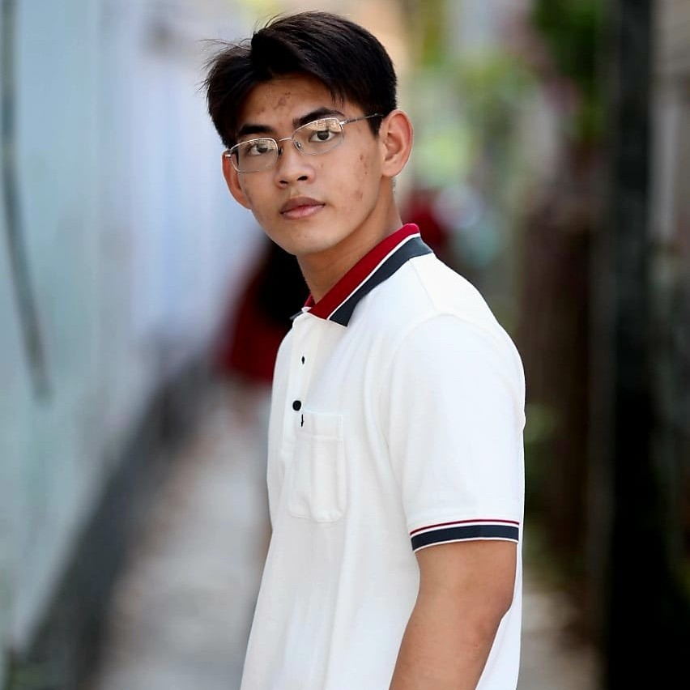

  
  <h1>Hello, I'm Le Pham Hoang Trung</h1>
  
AI Research Intern | AI, Data Science, and Web Development

  <a href="mailto:trungsanglong@gmail.com">Email</a> | <a href="https://github.com/Trunkg0d">GitHub</a>

## 🚀 About Me

I'm enthusiastic about leveraging technology to solve interesting problems. My journey in IT has allowed me to gain experience in various fields, from developing web applications to exploring the intricacies of AI. I've also had the opportunity to participate in AI and Web development contests and hackathons, with some success. My goal is to contribute meaningfully to the fields of Artificial Intelligence or Data Science.

## 🎯 Research Directions

- **Multimodal AI**: Integrating multiple types of data (text, images, audio, etc.) for enhanced AI models.  
- **Machine Unlearning**: Exploring techniques to efficiently remove learned data from AI models for privacy and security.   
- **AI Security & Robustness**: Studying adversarial attacks, model resilience, and defense strategies.  
- **Natural Language Processing (NLP)**: Investigating text generation, retrieval-augmented generation (RAG), and semantic understanding.  
- **Computer Vision**: Object detection, image segmentation, and generative AI applications.  

## 🎓 Education

- **BSc in Artificial Intelligence** - University of Science, VNUHCM  
  - **GPA:** 9.11/10 (as of Dec 2024)  
  - **Scholarships:** Multiple awards for academic excellence

## 🛠 Skills

- **Programming:** Python, Ruby, C++, SQL  
- **Machine Learning:** Scikit-learn, NumPy, Pandas  
- **Deep Learning:** TensorFlow, PyTorch  
- **Natural Language Processing:** Chatbots, RAG, Sentiment Analysis, Text Similarity  
- **Computer Vision:** OpenCV, Object Detection, Image Processing  
- **Software & Web:** Ruby on Rails, Flask, FastAPI, Docker 

💡 *Thank you for visiting my blog! I hope you find valuable insights, research, and projects here. Feel free to explore and connect with me!* 🚀
