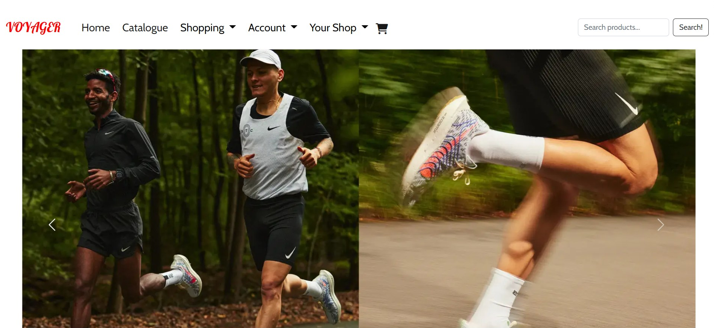
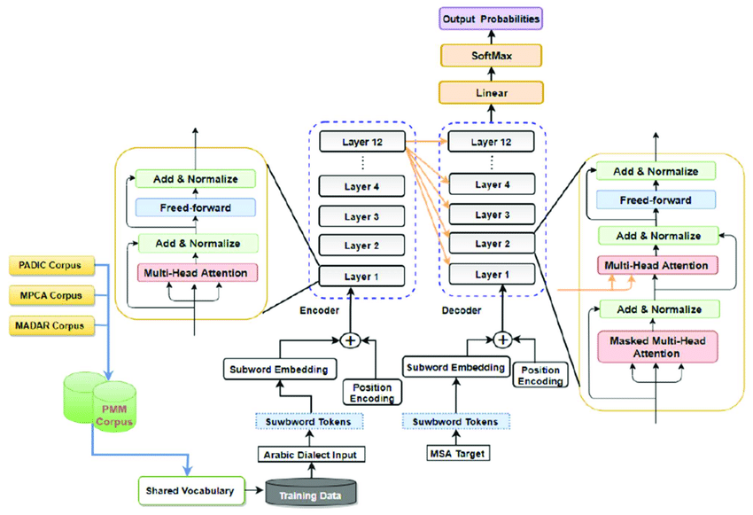
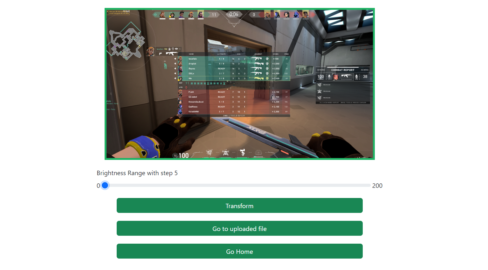
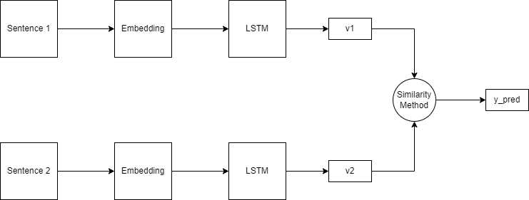
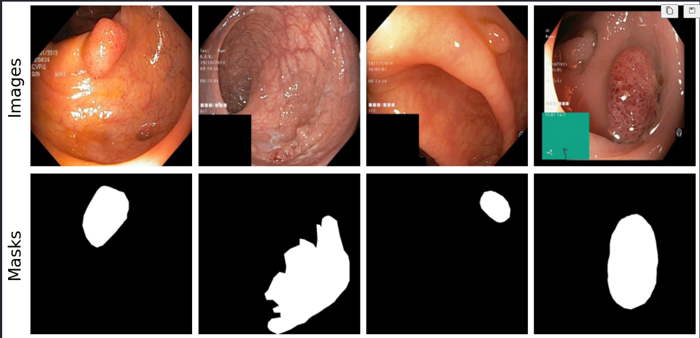

## Projects

### 1. Voyager Shopping Cart

  
  

    **GitHub:** [Trunkg0d/Voyager-shopping-cart](https://github.com/Trunkg0d/Voyager-shopping-cart) 
    **Description:** Full-stack e-commerce platform with product listings, cart management, and user authentication. Built using Ruby on Rails, ReactJS, and PostgreSQL.
  

  

### 2. Neural Machine Translation

  
  

    **GitHub:** [Trunkg0d/Neural-Machine-Translation](https://github.com/Trunkg0d/Neural-Machine-Translation) 
    **Description:** Neural Machine Translation system for English to Portuguese, employing a Seq2Seq model with attention mechanism.
  

  

### 3. Image Transform Web

  
  

    **GitHub:** [Trunkg0d/Image_Transform_Web](https://github.com/Trunkg0d/Image_Transform_Web) 
    **Description:** Web application for image manipulation, including color adjustments, shape transformations, smoothing, and edge detection. Built with Flask and Python.
  

  

### 4. Text Similarities Tool

  
  

    **GitHub:** [Trunkg0d/Text_Similarities_Tool](https://github.com/Trunkg0d/Text_Similarities_Tool) 
    **Description:** Tool for identifying text similarities in a local corpus using Siamese networks, fine-tuned with pre-trained models. Developed with PyTorch, Hugging Face, and Streamlit.
  

  

### 5. Medical Image Segmentation

  
  

    **GitHub:** [Trunkg0d/Medical-Image-Segmentation](https://github.com/Trunkg0d/Medical-Image-Segmentation) 
    **Description:** Deep learning project for medical image segmentation, analyzing CT and MRI scans to detect and segment abnormalities.
  

